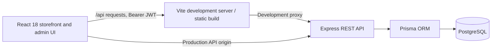

# CartNest architecture

## System overview



In development, Vite serves the frontend on port 5173 and proxies `/api` to Express on port 5000. In production, host the static `frontend/dist` bundle and API separately, set the API origin in `VITE_API_URL`, and allow the frontend origin using backend `CLIENT_URL`.

## Project structure

```text
backend/
  prisma/                 Prisma schema, SQL migrations, and safe empty-DB seed
  src/config/             Environment and Prisma client setup
  src/controllers/        HTTP request/response handlers
  src/middleware/         Authentication, authorization, validation, errors
  src/routes/             Public, customer, order, and admin route groups
  src/services/           Business rules and database transactions
  src/validators/         Zod request schemas
  tests/                  Jest and Supertest integration tests
frontend/
  src/components/         Shared customer and admin UI
  src/context/            Authentication, cart, and toast state
  src/layouts/            Customer and admin layouts
  src/pages/               Customer and admin routes
  src/services/api.js     Fetch client and endpoint wrappers
  src/utils/              Small frontend helpers
  public/                  Local image fallback
docs/                      Architecture, API, QA, ERD, and demo materials
```

## Request and authorization flow

1. React calls the central fetch client. It adds `Authorization: Bearer <JWT>` when a token exists and adds `Idempotency-Key` for checkout.
2. Express mounts route groups below `/api`. Zod middleware validates relevant request bodies, params, and query strings.
3. `authenticate` verifies token signature/expiry and loads a minimal user projection from PostgreSQL; `authorize('ADMIN')` enforces server-side role checks.
4. Controllers delegate business operations to services. Prisma performs relational queries and transaction work.
5. A centralized error handler returns API errors; the health endpoint reports connectivity without exposing the underlying database error.

## Database and transactions

PostgreSQL is the source of truth for users, products, variants, carts, addresses, orders, payments, stock movements, audit logs, and idempotency records. See [the ER diagram](ER_DIAGRAM.md).

Checkout re-reads current product/variant prices and availability, conditionally decrements stock, snapshots order items, creates payment/order/status and inventory records, records the idempotency response, and clears the cart within a database transaction. Admin inventory adjustments and order lifecycle operations also run server-side with audit/history writes.

## API documentation

Start the backend and open `/api/docs` for Swagger UI or `/api/docs/swagger.json` for the generated OpenAPI document. Endpoint groups and authentication expectations are summarized in [API documentation](API.md).
